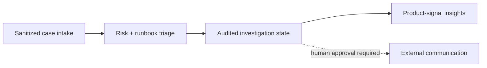

<div align="center">

# SupportOps Copilot

**An internal support investigation workflow with a hard human-approval boundary.**

[](https://github.com/Emmanuelasika/SupportOpsCopilot/actions/workflows/ci.yml)
[](https://emmanuelasika.github.io/SupportOpsCopilot/)
[](LICENSE)
[](https://www.python.org/)
[](CHANGELOG.md)

</div>

SupportOps Copilot turns a support case into a safe internal investigation
brief. It does **not** pretend to be an autonomous customer-reply agent:
intake is redacted, transitions are auditable, and every customer-facing action
remains outside the system and requires human authorization.

**[Explore the interactive project site →](https://emmanuelasika.github.io/SupportOpsCopilot/)**

## What is implemented



- **Case ledger:** create, filter, retrieve, and transition cases.
- **Operational ownership:** assign cases and calculate priority-specific SLA
  deadlines.
- **Safety boundary:** redact known secret forms before they reach SQLite or API
  responses.
- **Audit trail:** every transition records actor, state, sanitized note, and
  timestamp.
- **Guarded state machine:** invalid workflow jumps return `409`.
- **Safe exports:** generate a Markdown engineering handoff without raw secrets.
- **Product feedback:** aggregate case volume by category and status rather
  than using raw tickets as a proxy for root cause.

## Quick start

```bash
git clone https://github.com/Emmanuelasika/SupportOpsCopilot.git
cd supportops-copilot
python -m venv .venv && source .venv/bin/activate
pip install -r requirements.txt
uvicorn app.main:app --reload
```

Visit `http://localhost:8000/docs` for interactive API documentation.
The root route provides an interactive intake and case-queue UI.

## Example workflow

```bash
curl -sX POST http://localhost:8000/api/cases \
  -H 'content-type: application/json' \
  -d '{"subject":"Cannot access project","description":"403 after SSO login","area":"access"}'
```

The response includes a redacted case, risk level, internal next action, and
`requires_human_approval: true`. Move the case through the workflow with:

```bash
curl -sX POST http://localhost:8000/api/cases/<case_id>/transitions \
  -H 'content-type: application/json' \
  -d '{"status":"investigating","actor":"on-call","note":"Collected correlation ID"}'
```

## Production boundaries

This is a portfolio reference implementation. Before real use, add auth,
tenant isolation, a reviewed PII/secret policy, durable audit retention,
authorization for transitions, and an approved escalation integration.

## Quality gates

```bash
python -m compileall -q app
python -m pytest -q
```

CI runs these checks on pushes and pull requests. Contributions must preserve
the no-autoreply and redaction guarantees. Read the
[architecture and invariants](docs/architecture.md) before changing persistence
or workflow behavior. Released under the [MIT License](LICENSE).
