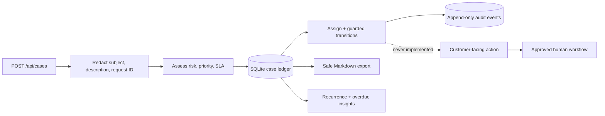

<div align="center">

# Support Operations Workbench

**A small, inspectable operations desk for support cases that should never be handled by “just let the AI reply.”**

[](https://github.com/Emmanuelasika/support-operations-workbench/actions/workflows/ci.yml)
[](https://emmanuelasika.github.io/support-operations-workbench/)
[](https://www.python.org/)
[](https://fastapi.tiangolo.com/)
[](LICENSE)

**[Open the annotated operations desk →](https://emmanuelasika.github.io/support-operations-workbench/)**

</div>

---

## Why I built this

The difficult part of product support is rarely writing a polite reply. It is
turning an incomplete report into safe evidence, deciding who owns it, keeping
the investigation moving, and making sure the same failure does not quietly
return for the twentieth customer.

I built Support Operations Workbench to demonstrate that workflow. It is intentionally
not a chatbot. It does not send email, invent remediation, or silently mutate a
customer account. Instead, it gives a support engineer a compact operational
ledger:

- redact credential-shaped data **before it reaches storage**;
- calculate priority and an SLA deadline from impact, risk, and environment;
- attach the relevant investigation runbook;
- assign an owner and enforce legal case-state transitions;
- append an actor-stamped audit event for every operational change;
- export a sanitized engineering handoff; and
- surface repeated fingerprints as a prompt for product investigation.

The project is useful as a local incident desk, an API reference for a support
platform, or a starting point for discussing safe automation in a support
engineering interview.

## A case, end to end

Imagine an integration customer reports that production webhooks stopped
arriving after a deployment. They paste an API token into the description—a
very normal support mistake.

### 1. Capture the report

```bash
curl -s http://localhost:8000/api/cases \
  -H 'content-type: application/json' \
  -d '{
    "subject": "Production webhooks return 500",
    "description": "Started 14:32 UTC. Bearer sk-live-do-not-store-123456. Request req_9d7. Three tenants affected.",
    "area": "technical",
    "customer_impact": "high",
    "request_id": "req_9d7",
    "environment": "production"
  }'
```

The stored and returned record is safe to inspect:

```json
{
  "id": "case_92fd8c10b614",
  "risk": "critical",
  "priority": "P1",
  "status": "new",
  "due_at": "2026-07-29T15:32:00+00:00",
  "safe_case": {
    "subject": "Production webhooks return 500",
    "description": "Started 14:32 UTC. [REDACTED] Request req_9d7. Three tenants affected."
  },
  "investigation": "Collect a minimal reproduction, UTC timestamp, request ID, and sanitized error response.",
  "requires_human_approval": true,
  "customer_message": "Not generated: communication is owned by an approved human workflow."
}
```

The P1 is not decoration: high-impact or security-sensitive cases receive a
one-hour deadline. A production case that is not critical becomes P2 with an
eight-hour deadline; lower-risk work is P3 with a 24-hour deadline.

### 2. Make ownership explicit

```bash
curl -sX POST http://localhost:8000/api/cases/case_92fd8c10b614/assignment \
  -H 'content-type: application/json' \
  -d '{"assignee":"webhooks-on-call","actor":"support-triage"}'
```

Assignment is written to both the case and its append-only activity history.
There is no ambiguous “someone is looking at it” state.

### 3. Move through a guarded investigation

```bash
curl -sX POST http://localhost:8000/api/cases/case_92fd8c10b614/transitions \
  -H 'content-type: application/json' \
  -d '{
    "status":"investigating",
    "actor":"webhooks-on-call",
    "note":"Reproduced with req_9d7; signature verification fails before handler execution."
  }'
```

The workflow permits:

```text
new ───────► investigating ───────► awaiting_approval
 │                   ▲                      │
 └──────► resolved   └──────────────────────┘
                     investigating/approval ──► resolved
```

An attempt to jump directly from `new` to `awaiting_approval` receives `409
Conflict`. This matters because a UI should not be able to bypass the
investigation just because it sends a valid status string.

### 4. Hand engineering evidence, not a ticket dump

```bash
curl -s http://localhost:8000/api/cases/case_92fd8c10b614/export
```

The export is Markdown containing priority, owner, deadline, sanitized customer
evidence, the investigation direction, and the complete audit trail. It can be
copied into an engineering issue without bringing the pasted token with it.

### 5. Look beyond the single case

`GET /api/insights` groups identical sanitized case fingerprints and reports
overdue open work. If five customers report the same webhook failure, the
useful response is not five heroic ticket closures—it is validating the shared
cause and opening one evidence-backed product issue.

The API deliberately labels this as a *signal*, not a diagnosis. Ticket volume
alone does not prove root cause.

## When I would use it

| Situation | What Support Operations Workbench contributes |
| --- | --- |
| A support team is passing incidents around in chat | A shared owner, status, deadline, and audit trail |
| Customers paste credentials into tickets | Redaction at the intake and transition boundaries |
| Engineering receives vague escalations | A consistent, sanitized Markdown handoff |
| High-impact cases stall between teams | Priority-specific SLA deadlines and an overdue count |
| The same symptom keeps returning | Stable fingerprints that make recurrence visible |
| A team is considering an AI support agent | A concrete example of where automation should stop and human approval should begin |

It is **not** a replacement for Zendesk, PagerDuty, a security incident response
platform, or a production authorization system. It is a focused reference
implementation of the seam between customer support and engineering.

## How a request moves through the system



### Decisions encoded in the service

| Decision | Rule in this implementation | Why it is visible |
| --- | --- | --- |
| Critical risk | Security area, security-incident language, or high customer impact | Operators can challenge deterministic policy |
| Priority | Critical → P1; production/medium impact → P2; otherwise P3 | No opaque model score controls urgency |
| SLA | P1 1h, P2 8h, P3 24h | Deadline is persisted and queryable |
| Runbook | Selected by `access`, `billing`, `technical`, or `security` | Advice stays bounded to a reviewed path |
| State change | Must exist in `ALLOWED_TRANSITIONS` | Invalid jumps fail with 409 |
| Customer communication | Not implemented | The API always reports human approval required |

There is no LLM dependency. The workbench provides operational decision
support, not probabilistic authority. That choice makes the safety behavior
reproducible and testable.

## API map

| Method | Route | Purpose |
| --- | --- | --- |
| `POST` | `/api/cases` | Sanitize, prioritize, and persist a case |
| `GET` | `/api/cases` | Filter the queue by area or status |
| `GET` | `/api/cases/{id}` | Retrieve the case, runbook, and audit history |
| `POST` | `/api/cases/{id}/assignment` | Assign an owner and record the actor |
| `POST` | `/api/cases/{id}/transitions` | Apply an allowed state change |
| `GET` | `/api/cases/{id}/export` | Produce a safe Markdown handoff |
| `GET` | `/api/runbooks` | Inspect the four built-in runbooks |
| `GET` | `/api/insights` | Find recurring fingerprints and overdue work |
| `GET` | `/health` | Report service and safety-boundary status |

FastAPI also exposes an interactive schema at `/docs`.

## Run it

```bash
git clone https://github.com/Emmanuelasika/support-operations-workbench.git
cd support-operations-workbench
python -m venv .venv
source .venv/bin/activate          # Windows: .venv\Scripts\activate
pip install -r requirements.txt
uvicorn app.main:app --reload
```

Open `http://localhost:8000` for the working case queue or
`http://localhost:8000/docs` for the API explorer. Data is stored in
`supportops.sqlite3`; delete that local file when you want a clean demo.

Container users can run:

```bash
docker build -t support-operations-workbench .
docker run --rm -p 8000:8000 support-operations-workbench
```

## Quality and safety checks

```bash
python -m compileall -q app
python -m pytest -q
```

The tests exercise redaction, priority/SLA calculation, filters, runbook
selection, assignment auditing, guarded transitions, safe exports, recurrence,
unknown cases, and the GitHub Pages artifact. GitHub Actions repeats the suite
on Python 3.11 and 3.12, then builds the container and probes `/health`.

The central invariants are:

1. credential-shaped input is redacted before persistence;
2. every assignment and transition is attributable;
3. invalid workflow jumps are rejected;
4. exported evidence contains the sanitized record;
5. the service never generates or sends a customer message.

## Honest production gap

This is a portfolio-grade reference service, not a hosted multi-tenant support
system. A real deployment still needs:

- authentication and role-based authorization for every mutation;
- tenant isolation and an organization-scoped data model;
- a reviewed PII/secret detector beyond the demonstration regex;
- encryption, backups, retention/deletion controls, and monitored migrations;
- idempotency and concurrency controls for transitions;
- durable event delivery to an approved incident or ticketing platform;
- observability, rate limits, pagination, and operational alerting; and
- an organizationally approved escalation and customer-communication policy.

Those omissions are listed because deployment reality matters. The useful part
of this repository is the workflow and its boundaries—not pretending a small
SQLite service is already an enterprise platform.

## Repository guide

```text
app/main.py             API, policy decisions, persistence, exports, insights
app/static/index.html   working local intake and queue
tests/test_api.py       behavior and safety invariants
tests/test_site.py      public showcase integrity
docs/index.html         annotated GitHub Pages case study
docs/architecture.md    compact architecture reference
.github/workflows/      CI, container check, and Pages deployment
```

Start with [`app/main.py`](app/main.py) if you are reviewing implementation
choices, or visit the [live annotated case
study](https://emmanuelasika.github.io/support-operations-workbench/) if you want the
five-minute walkthrough.

Contributions are welcome under the [MIT License](LICENSE). Please read
[`CONTRIBUTING.md`](CONTRIBUTING.md) and preserve the documented safety
invariants.

— **Emmanuel Asika**
